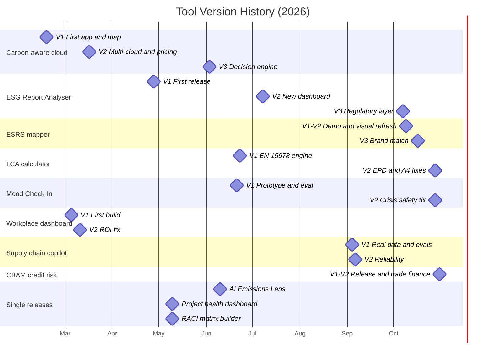

````markdown
# Hi, I'm Upasana Sen 👋

Sustainability Project Manager & ESG Data Specialist
Lund, Sweden
MSc Environmental Studies — Lund University
MSc Project Management — EAE Business School

---

## What I Build

I create sustainability-focused data tools that connect ESG, climate analysis, and project management.

### How my tools have evolved



---

## Skills & Tools

**Sustainability & ESG**
`Carbon Accounting` `CSRD` `EU Taxonomy` `LCA` `TCFD` `GHG Protocol` `ESG Reporting`

**AI & Data**
`Python` `Pandas` `NumPy` `Power BI` `Streamlit` `Data Visualisation`

**Project Management**
`Agile` `Scrum` `Backlog Management` `Stakeholder Management` `PRINCE2`

---

## 📫 Let's Connect

[LinkedIn](https://www.linkedin.com/in/upasana-sen-693830104/)
[Website](https://upasanasen.github.io)
[Email](mailto:upasana19sen95@gmail.com)

---
````
