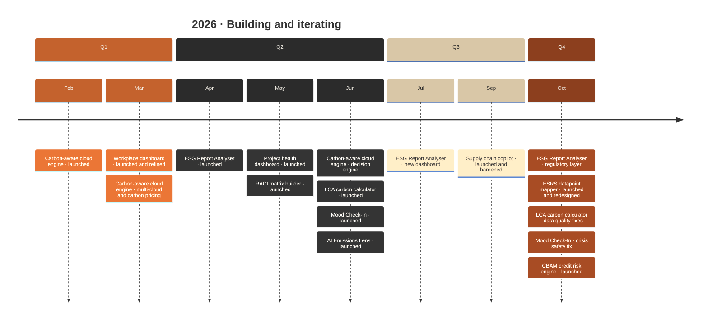

# Hi, I'm Upasana Sen 👋

Sustainability Project Manager & ESG Data Specialist  
Lund, Sweden  
MSc Environmental Studies — Lund University  
MSc Project Management — EAE Business School  

---

## What I Build

I create sustainability-focused data tools that connect ESG, climate analysis, and project management.

### How my tools have evolved

---

## Skills & Tools

**Sustainability & ESG**  
`Carbon Accounting` `CSRD` `EU Taxonomy` `LCA` `TCFD` `GHG Protocol` `ESG Reporting`

**AI & Data**  
`Python` `Pandas` `NumPy` `Power BI` `Streamlit` `Data Visualisation`

**Project Management**  
`Agile` `Scrum` `Backlog Management` `Stakeholder Management` `PRINCE2`

---

## 📫 Let's Connect

  
  

---
